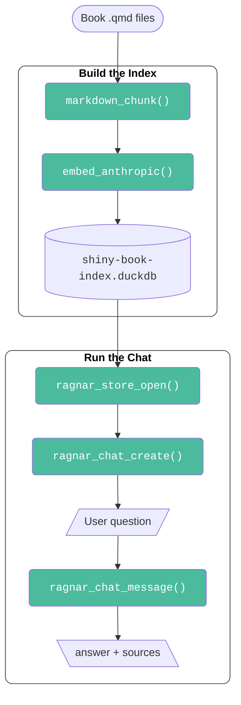
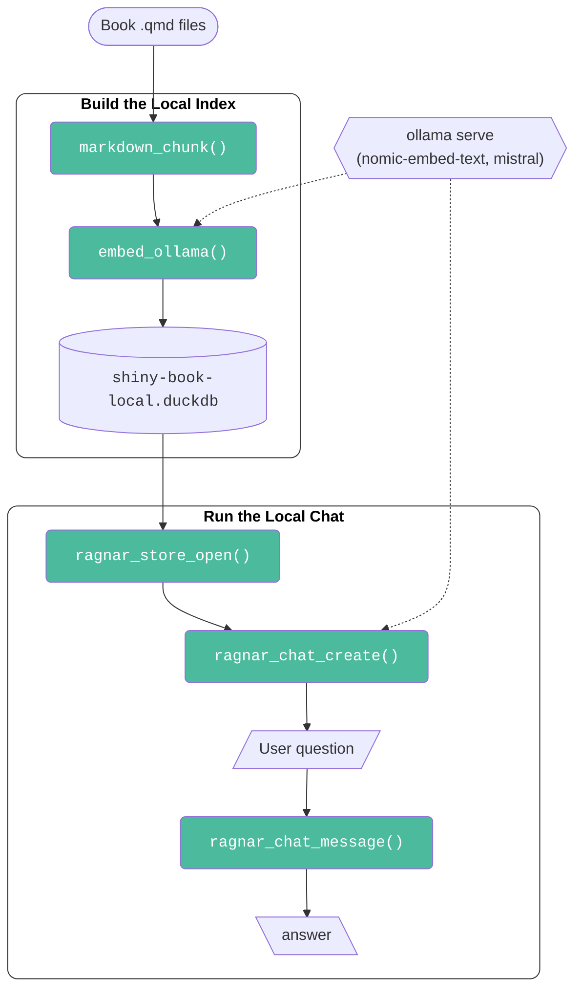

# Using `{ragnar}` To Build Chatbot For Shiny App-Packages (Quarto book)

This directory contains the instructions for building a Retrieval-augmented 
generation (RAG) chatbot from the [Shiny App-Packages](https://mjfrigaard.github.io/shiny-app-pkgs/) book.

## Install the Packages 

The following packages are required: 

```r
install.packages(c("ragnar", "duckdb"))
```


```r
library(ragnar)
library(duckdb)
```

## Quarto files 

The book's `.qmd` files locally (or URL access to them)   

```bash
git clone https://github.com/mjfrigaard/shiny-app-pkgs.git
cd shiny-app-pkgs
```

## Premier model

Assuming you have an API key from Anthropic or OpenAI, follow the instructions below for setting up the local index.



### API keys 

```bash
export ANTHROPIC_API_KEY="your-key-here"
# or for OpenAI:
export OPENAI_API_KEY="your-key-here"
```


### Build the index

```r
book_path <- "shiny-app-pkgs"
```

```r
chunks <- markdown_chunk(
  dir = book_path,
  pattern = "\\.qmd$"
)
```

`{ragnar}` sends chunks to Anthropic API, gets back vectors:

```r
embedded <- embed_anthropic(
  chunks,
  model = "claude-3-5-sonnet-20241022"
)
```

```r
store <- ragnar_store_create(
  embedded,
  path = "shiny-book-index.duckdb"
)
```

## Run the chat

Load your stored index:

```r
store <- ragnar_store_open("shiny-book-index.duckdb")
```

Start a chat session:

```r
chat <- ragnar_chat_create(
  store = store,
  model = "claude-3-5-sonnet-20241022",
  provider = "anthropic"
)
```

Ask a question

```r
response <- ragnar_chat_message(
  chat,
  "How do I structure file names for R6 class modules in a Shiny app-package?"
)
```

View response:

```r
cat(response$answer)
cat("\n\nSources:\n")
print(response$sources)
```

The response object includes:   
 - `$answer`: Claude's response grounded in your book   
 - `$sources`: List of chunks used to generate the response   
 - `$citations`: Links back to the `.qmd` files   


## Local model 

The instructions below show how to use `{ragnar}` with a locally stored index.



## Check requirements 

Before using ollama to build a local RAG chatbot, check the requirements. Read [requirements.md](https://github.com/mjfrigaard/shragnar/blob/main/requirements.md) to make sure your machine is capable. 

### Install Ollama

Pull a capable open model (nomic-embed-text for embeddings)

```r
ollama pull nomic-embed-text
```

Pull a chat model (e.g., mistral or neural-chat)

```r
ollama pull mistral
```

Start model 

```r
ollama serve
```

### Build a local index 


Chunk the book:

```r
chunks <- markdown_chunk(
  dir = "shiny-app-pkgs",
  pattern = "\\.qmd$"
)
```


Embed locally via Ollama:

```r
embedded <- embed_ollama(
  chunks,
  base_url = "http://localhost:11434",
  model = "nomic-embed-text"
)
```

Store in `{duckdb}` (same as before)

```r
store <- ragnar_store_create(
  embedded,
  path = "shiny-book-local.duckdb"
)
```

### Run the local chat

Load your local index:

```r
store <- ragnar_store_open("shiny-book-local.duckdb")
```

Start a chat session:

```r
chat <- ragnar_chat_create(
  store = store,
  model = "mistral",
  provider = "ollama",
  base_url = "http://localhost:11434"
)
```

Ask a question:

```r
response <- ragnar_chat_message(
  chat,
  "Explain the difference between module-based and R6-based architecture in Shiny app-packages."
)
```

View the response:

```r
cat(response$answer)
```


